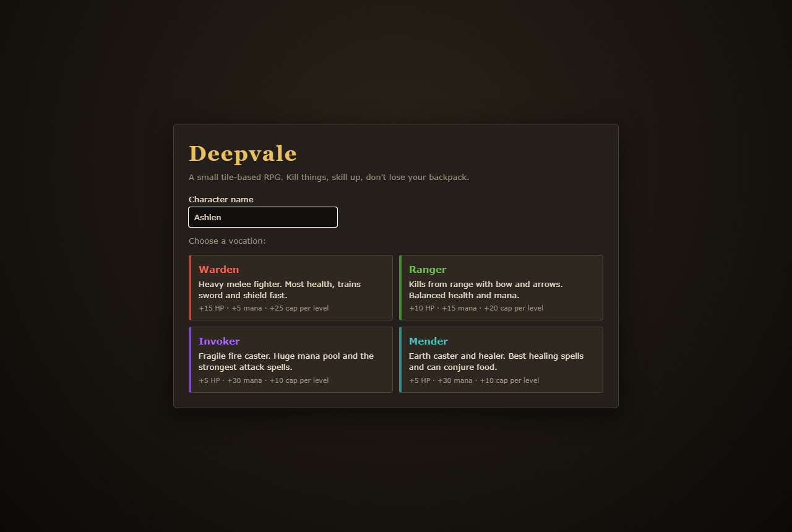
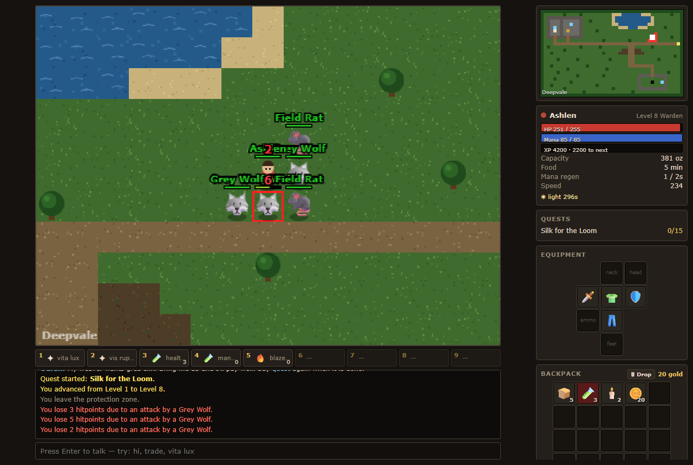
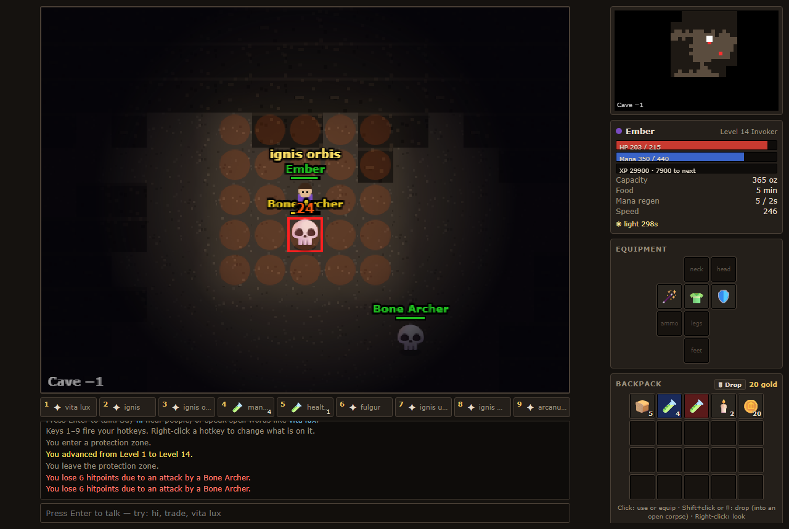
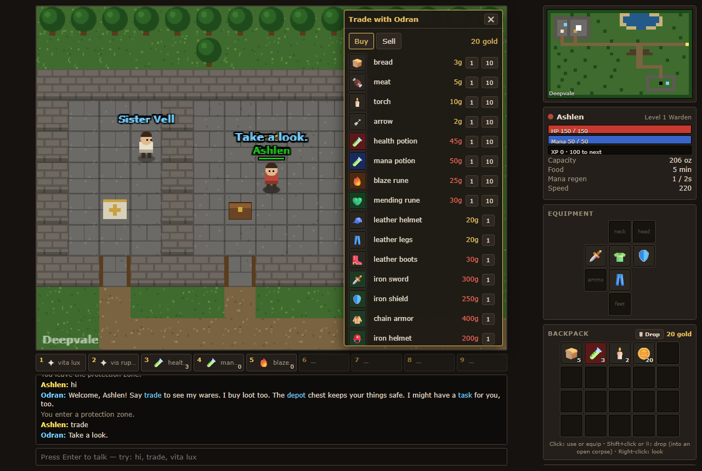
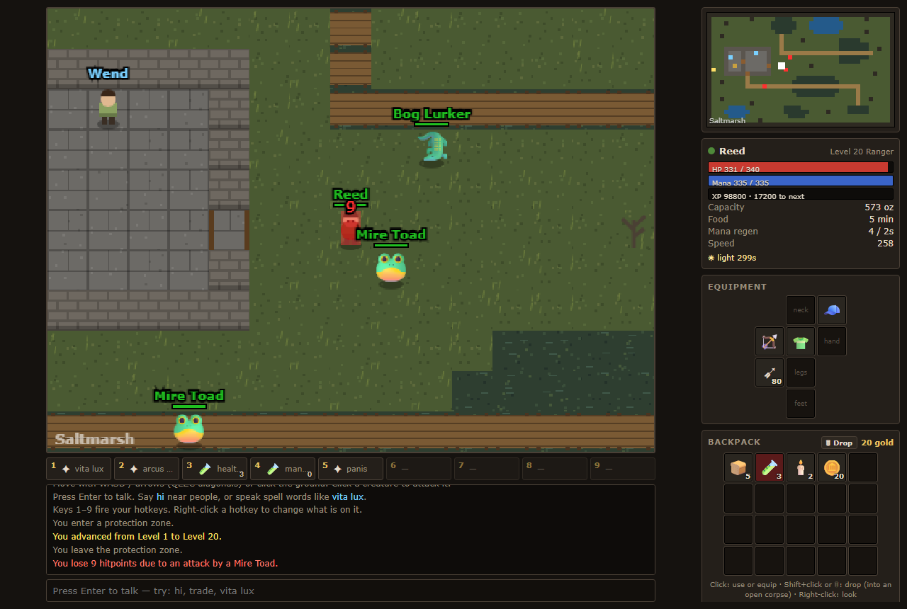
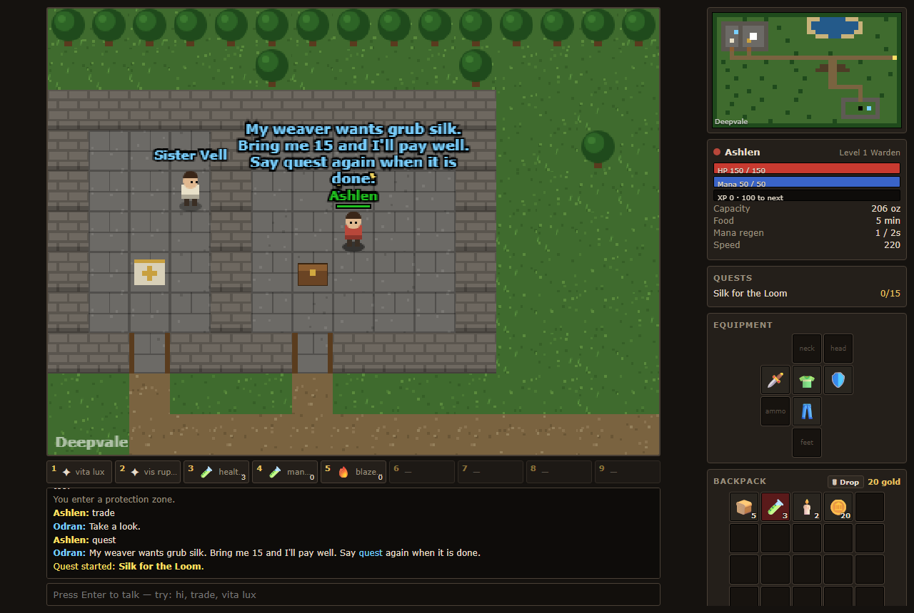

# Deepvale Game Guide

- [Getting started](#getting-started)
- [Controls](#controls)
- [How the world works](#how-the-world-works)
- [Spells](#spells)
- [Items and gear](#items-and-gear)
- [People of the valley](#people-of-the-valley)
- [Where to hunt](#where-to-hunt)
- [Quests](#quests)
- [Tips](#tips)

---

## Getting started

Open `index.html`, type a name and pick a vocation. Your choice is permanent for that character. Creating a new character replaces your save.

| Vocation | Plays like | Per level | Trains fastest |
|---|---|---|---|
| **Warden** | Front-line melee with sword and shield. The most health of any vocation. | +15 HP, +5 mana, +25 cap | Melee, shielding |
| **Ranger** | Shoots from up to 6 tiles away with a bow. Conjures arrows and can cloak. Balanced health and mana. | +10 HP, +15 mana, +20 cap | Distance |
| **Invoker** | Fragile fire caster with the strongest attack spells and the biggest spell list. | +5 HP, +30 mana, +10 cap | Magic |
| **Mender** | Earth caster and healer. Best healing, and can conjure food. | +5 HP, +30 mana, +10 cap | Magic |

Everyone starts in Deepvale's temple with basic gear, some bread, potions, two torches and 20 gold.

---

## Controls

| Action | How |
|---|---|
| Move | **WASD** or **arrow keys**. **Q E Z C** move diagonally. You can also click the ground. |
| Attack | Click a creature. **Space** targets the nearest one, **Tab** cycles through targets. |
| Talk and cast | **Enter**, then type. NPCs answer `hi`, keywords and `bye`. Spell words are cast as you say them. |
| Hotkeys | **1–9**. Right-click a hotkey to change what's on it. |
| Loot | Click a corpse next to you. |
| Look | Right-click anything. |
| Backpack | Click an item to use or equip it. **Shift+click** (or the **🗑 Drop** toggle) drops it. |
| Cancel | **Esc** closes a window or clears your target. |
| Sound | Click the speaker button in the side panel. |

The side panel has a **chase** toggle. When chase is on, you follow your target. Wardens start with it on.

---

## How the world works

**Combat runs on a 2-second tick.** Your weapon swings, fires or zaps once every 2 seconds while you have a target in range. Spells have their own cooldowns.

**Skills improve by use.** Melee rises from hitting things up close, distance from shooting, shielding from being attacked, and magic level from spending mana. Each vocation trains its own specialities faster.

**Food keeps you regenerating.** You regenerate health and mana every 2 seconds only while you're fed. Eat bread, meat or cheese from your backpack. The **Food** line in your stats shows how long you have left.

**Capacity limits what you carry.** Every item has a weight, and gold weighs nothing. Your backpack starts with 20 slots. A **traveler's pack** (30) or **delver's pack** (40) grows it for good when you use one.

**Caves are dark.** Light a torch (click it in your backpack) or cast `lumen`. Without light you can barely see a tile around you.

**Buildings are protection zones.** Monsters can't follow you inside or attack in. You also can't attack out, so you can't fight from a doorway.

### Death

When you die, you wake at the temple altar and:
- lose **10% of your experience**, which can cost you levels
- lose **half your progress** toward each next skill level
- **drop your whole backpack** where you fell, so go back and get it

An **amulet of warding** (1500 gold from Odran) shatters in place of your backpack: you keep your items once. Your equipped gear is never lost. Anything in the **depot chest** is always safe.

---

## Spells

Type the words and press Enter, or put them on a hotkey. Spells cost mana, need a minimum level, and some are only for certain vocations.

| Words | Spell | Lvl | Mana | Vocations | Effect |
|---|---|---|---|---|---|
| `vita lux` | Light Healing | 1 | 20 | all | Small heal |
| `lumen` | Light | 1 | 20 | all | Light radius for 3 minutes |
| `vigor` | Haste | 3 | 40 | all | +35% speed for 30s |
| `panis` | Conjure Bread | 2 | 40 | Ranger, Mender | One bread |
| `sagitta` | Conjure Arrows | 2 | 35 | Ranger | Puts 15 arrows straight into your quiver |
| `ignis` | Fire Strike | 2 | 20 | Invoker, Mender | Ranged fire hit (4 tiles) |
| `terra spina` | Thorn Strike | 4 | 20 | Mender | Ranged earth hit (4 tiles) |
| `vita magna` | Greater Healing | 8 | 70 | Mender | Big heal |
| `vis ruptor` | Cleave | 5 | 50 | Warden | Hits every adjacent enemy |
| `arcus vis` | Spirit Arrow | 5 | 25 | Ranger | Magic shot that scales with distance skill (5 tiles) |
| `umbra` | Cloak | 6 | 20 | Ranger | Creatures can't see you. Drains 1 mana/s. Attacking, recasting, or running out of mana ends it |
| `saltus` | Disengage | 7 | 30 | Ranger | Leap 2 tiles away from your target |
| `arcus ictus` | Power Shot | 8 | 40 | Ranger | Heavy bow shot (1.8× damage), uses 1 arrow |
| `venator` | Hunter's Focus | 10 | 60 | Ranger | 30s: bow shots every 1.5s and +10% hit chance |
| `arcus nodus` | Snare Shot | 12 | 50 | Ranger | Bow shot that slows the target to half speed for 5s |
| `sagitta magna` | Conjure Barbed Arrows | 14 | 80 | Ranger | Puts 10 barbed arrows into your quiver |
| `fulgur` | Lightning Bolt | 5 | 30 | Invoker | Ranged hit (5 tiles) |
| `runa ignis` | Conjure Blaze Runes | 6 | 100 | Invoker | Makes 3 blaze runes |
| `portus` | Shop Portal | 6 | 60 | Invoker | Opens a portal to Odran's shop. Cast again to return. |
| `ignis orbis` | Fire Ring | 8 | 90 | Invoker | Fire around you (radius 2) |
| `ignis unda` | Flame Wave | 10 | 80 | Invoker | Cone of fire where you face |
| `ignis magna` | Great Fireball | 12 | 60 | Invoker | Heavy ranged hit |
| `arcanum scutum` | Mana Shield | 14 | 50 | Invoker | Damage drains mana before health, for 3 minutes |
| `ignis pluvia` | Firestorm | 20 | 220 | Invoker | Big area of fire (radius 3) |

**Marsh rites.** Each vocation has one more spell, taught by Wend in the Saltmarsh (see [Quests](#quests)). All need level 20.

| Words | Spell | Vocation | Mana | Effect |
|---|---|---|---|---|
| `vis tremor` | Earthquake | Warden | 120 | Area damage that scales with melee skill |
| `arcus pluvia` | Arrow Rain | Ranger | 110 | Area damage that scales with distance skill |
| `tempestas` | Tempest | Invoker | 110 | Very heavy ranged hit |
| `terra unda` | Earth Wave | Mender | 90 | Cone of earth damage |

**Runes** are used from the backpack or a hotkey. A **blaze rune** is an attack, and a **mending rune** heals. Anyone can use them.

---

## Items and gear

Gear goes in eight slots: amulet, head, armor, weapon, shield, legs, feet, ammo. The colour behind an item hints at how rare it is.

- **Wardens** want the highest-attack melee weapon and the best shield and armor they can carry.
- **Rangers** need a bow and arrows in the ammo slot. Bows are two-handed. **Barbed arrows** (Wend) hit harder. When the quiver empties, arrows in your backpack refill it automatically. About 40% of arrows that hit can be recovered from the corpse. Out of arrows completely? You throw a (very weak) punch at anything next to you.
- **Casters** use wands (Invoker) or rods (Mender), which spend a little mana per shot. **Cloth gear** (robes, hoods, tomes) has little armor but adds mana regen and max mana.
- **Wader boots** let you walk through bog and mud at full speed. They're worth it in the Saltmarsh.

Most of the best caster and high-level gear is **drop-only**. Check every corpse. Sell creature parts (pelts, silk, cores, charms, pearls) to the shops for gold.

---

## People of the valley

Walk up to someone, press Enter and say `hi`. Words in **[brackets]** in their replies are keywords you can ask about.

| Who | Where | What they do |
|---|---|---|
| **Sister Vell** | Deepvale temple | Heals you for free (`heal`). Explains death and vocations. |
| **Odran** | Deepvale shop | Full shop (`trade`), buys loot, and gives a quest. The depot chest is next to him. |
| **Old Brann** | The stone ring south-east of town | Guards the hole into the caves. Knows about the King and the seal. |
| **Captain Maren** | Saltmarsh outpost | Gives two quests. |
| **Wend** | Saltmarsh outpost | Potions, arrows, runes and wader boots. Teaches the marsh rites. |

---

## Where to hunt

| Area | How to get there | Creatures | Suggested level |
|---|---|---|---|
| **Deepvale fields** | Outside town | Field Rat, Grey Wolf | 1–5 |
| **Cave −1** | The hole inside Old Brann's stone ring | Cave Grub, Bone Archer, rats | 4–10 |
| **Cave −2** | Hole in the north-west room of Cave −1 | Ember Golem, Bone Archer, **The Hollow King** (boss) | 10–15 |
| **Saltmarsh** | Road sign at the east end of the dirt road | Mire Toad, Bog Lurker, Fen Hag, Drowned Knight | 15–25 |
| **Sunken Vault** | Sealed hole in the Hollow King's hall (see Quests) | Silt Wraith, Vault Sentinel, **The Mother of Silt** (boss) | 25+ |

Monster notes:
- **Bone Archers, Fen Hags and Silt Wraiths** shoot from range and keep their distance. Close in or out-range them.
- **Fen Hags** also throw an area curse every few seconds.
- **The Hollow King** (1000 HP) casts *GRAVE FLAME!* around himself. Bring lots of health potions.
- **The Mother of Silt** (4500 HP) floods the area with *SILT TIDE!* and calls up Silt Wraiths every 15 seconds.
- **Bosses** take 5–10 minutes to come back after a kill. Their summons never respawn and drop nothing.

The minimap in the top-right reveals cave floors as you explore them. On the minimap, white is you, blue dots are NPCs, red dots are nearby monsters and magenta is a boss.

---

## Quests

Say `quest` or `task` to an NPC to take their quest. Say it again when you're done to turn it in. Active quests show in the side panel.

<b>Quest list (spoilers)</b>

| Quest | Giver | Task | Reward |
|---|---|---|---|
| **Silk for the Loom** | Odran | Bring 15 grub silk (Cave Grubs) | 800 gold + 3 great health potions |
| **The Hollow Crown** | Old Brann | Bring the Hollow King's crown | 2000 XP, and Brann breaks the seal to the **Sunken Vault** |
| **Bog Clearing** | Captain Maren | Kill 20 Bog Lurkers | 3000 XP + 1000 gold |
| **Hag Charms** | Wend | Bring 8 hag charms (Fen Hags) | 2500 XP + your vocation's **marsh rite** spell |
| **The Mother of Silt** | Captain Maren | Kill the Mother of Silt (unlocks after *The Hollow Crown*) | 6000 XP + **tear of silt**, a strong mana amulet |

---

## Tips

- **Bank your loot.** Before a risky hunt, put spare gold and valuables in the depot. You only lose what's in your backpack.
- **Keep potions on hotkeys.** Health and mana potions are on your bar by default.
- **Stick to the boardwalks** in the Saltmarsh. Bog water slows you to a crawl.
- **Invokers** can `portus` to the shop mid-hunt to sell and restock, then cast it again to go back.
- **Menders and Rangers** never need to buy food: `panis` makes bread. Rangers can conjure arrows too (`sagitta` from level 2).
- **Shift+click** junk out of your backpack while a corpse is open, to make room for better loot.
- **Right-click a creature** to see how hurt it is.
