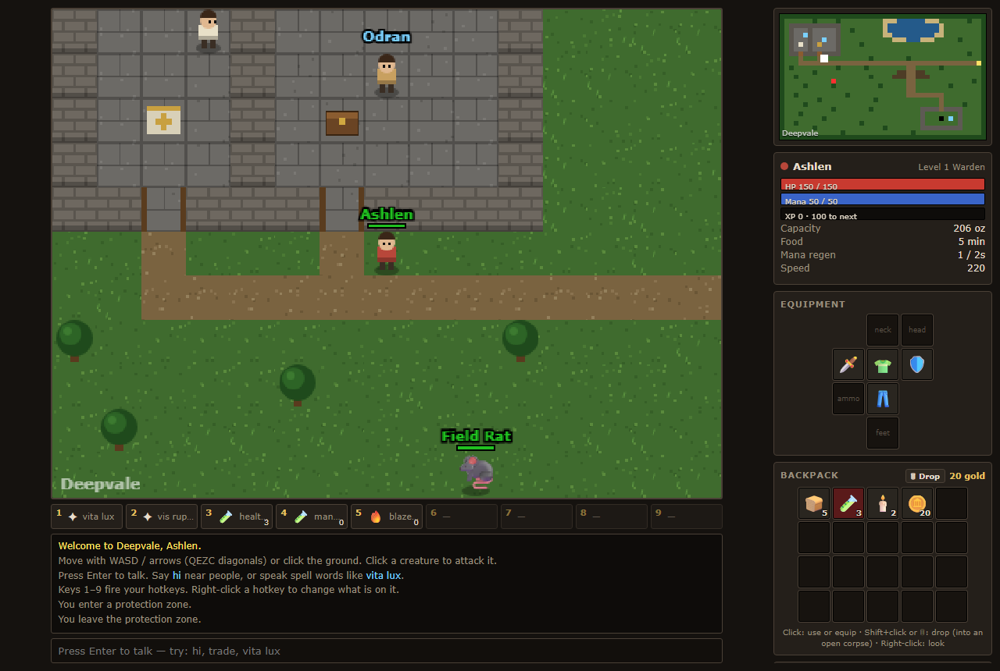

# Deepvale

A small single-player tile RPG that runs in your browser. Pick a vocation, train your skills by using them, speak spells out loud, trade with the townsfolk, and go down into the dark under the valley. If you die, you wake at the temple, but your backpack stays where you fell.

## Play

Download or clone the repo and double-click `index.html`. You don't need a server, a build step or an install. Progress saves automatically to your browser's localStorage.

**New here? Read the [Game Guide](GUIDE.md).**

## What's in it

- 4 vocations: Warden, Ranger, Invoker and Mender
- Skills that improve by use, a level curve and a harsh death penalty
- 20+ typed spells, attack and healing runes, potions
- NPCs that answer keywords (`hi`, `trade`, `quest`…), shops and a depot
- Two outdoor regions, three cave floors and two bosses
- Data-driven quests, a minimap that reveals as you explore, synthesized sound effects

## Under the hood

Vanilla JavaScript and HTML5 Canvas, with no dependencies. All game content (map, creatures, items, spells, NPCs, quests) lives in [`js/data.js`](js/data.js), and adding content means adding an entry there.

Guide screenshots are generated with Playwright: `pip install playwright && playwright install chromium`, then `python scripts/screenshots.py`.
